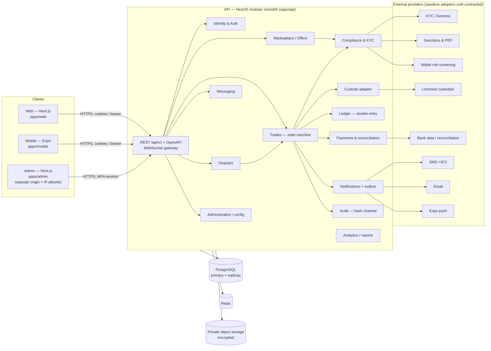

# Architecture

## 1. Shape: modular monolith

One NestJS API process (horizontally scalable, stateless) with strict module boundaries, one PostgreSQL
database, Redis for rate limits / socket fan-out / queues in production. Three clients share it.

## 2. Module boundaries

Each domain lives in `apps/api/src/modules/<domain>`. Rules:

- A module exposes a service; other modules call the service, never its tables directly
  (enforced by review; tables are prefixed by domain in the schema docs).
- Cross-module side effects that must not be lost (notifications, webhooks) go through the
  **transactional outbox** (`OutboxEvent`), written in the same DB transaction as the state change.
- External providers sit behind interfaces in `modules/integrations/*`. Each interface has a
  `Sandbox*` implementation (clearly named, refuses to run when `TRADING_MODE=PRODUCTION`) and a
  placeholder for the real provider, to be implemented only against a verified API contract.

## 3. Key decisions (see `docs/adr`)

| ADR | Decision |
|---|---|
| 0001 | Modular monolith over microservices |
| 0002 | Integer minor units with `bigint`; prices in 1/10,000 ₪ |
| 0003 | Explicit state machines in `packages/shared`, transitions executed with row locks |
| 0004 | Double-entry ledger separate from custodian balances; reconciliation job |
| 0005 | Sandbox-by-default with production gates checked at boot |
| 0006 | Cookie sessions (web) + bearer (mobile), rotating refresh tokens with reuse detection |
| 0007 | DB-backed scheduler fallback when Redis is unavailable |

## 4. Request lifecycle for a state change

1. Auth guard resolves the session; `PermissionsGuard` checks the required permission.
2. Zod validation (schemas shared with clients).
3. `Idempotency-Key` header looked up; a replay returns the stored response.
4. `prisma.$transaction` (Serializable or row lock `SELECT … FOR UPDATE`) loads the aggregate,
   asks the shared state machine whether `from → to` is legal **for this actor**, applies effects
   (ledger postings, custody holds through adapter, offer quantity), writes `TradeEvent`,
   `AuditEvent` and `OutboxEvent` rows.
5. After commit: the outbox dispatcher pushes WebSocket updates and notifications.

## 5. Security architecture (summary — see THREAT-MODEL.md)

- Argon2id password hashing; TOTP MFA (mandatory for staff); WebAuthn passkeys (planned, see STATUS).
- Access tokens 15 min, refresh tokens rotated and stored hashed; reuse ⇒ whole session family revoked.
- Web: httpOnly `SameSite=Lax` cookies + CSRF double-submit token on unsafe methods.
- Admin API routes require `staff` role **and** an MFA-verified session.
- Uploads: size cap, magic-byte type sniffing, malware-scan hook, AES-256-GCM encryption at rest,
  served only through authorised, short-lived download endpoints.
- Audit events are hash-chained and append-only (DB triggers block UPDATE/DELETE).
